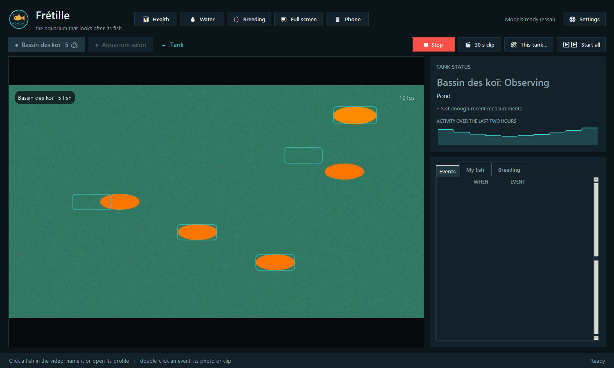
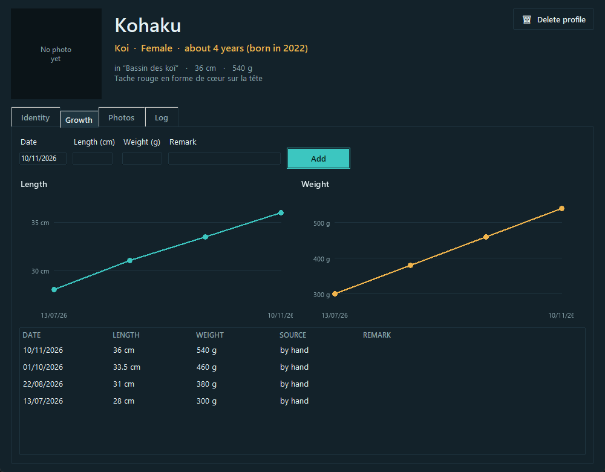
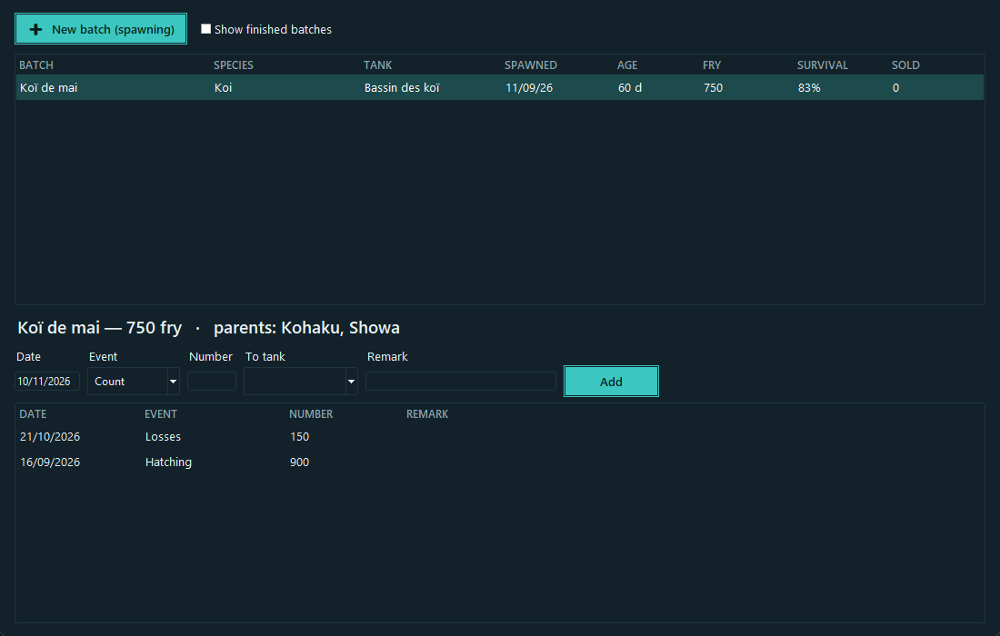
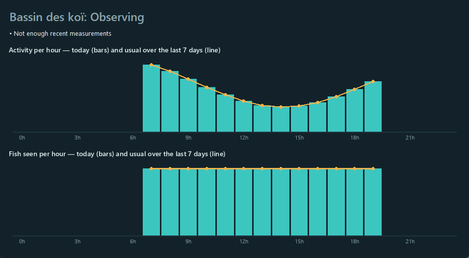
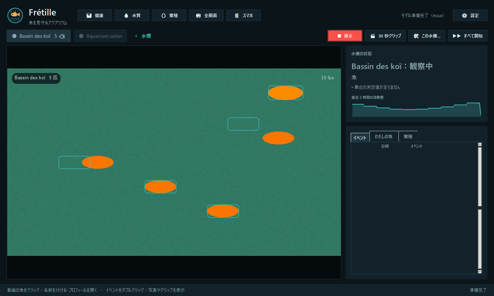

# Frétille

**L'aquarium qui veille sur ses poissons.** Une caméra par bac (aquarium, bassin à koï, bac d'élevage), et Frétille surveille pour vous, jour et nuit, sur un PC Windows.

🌍 [English](README.md) · Français. L'appli parle 13 langues : français, anglais, espagnol, allemand, portugais, italien, néerlandais, chinois, japonais, coréen, thaï, vietnamien et indonésien.

**[⬇ Télécharger Fretille-Setup.exe](https://github.com/Oli97430/fretille/releases/latest/download/Fretille-Setup.exe)** · [Guide d'utilisation](GUIDE.md) · [User guide](GUIDE.en.md)



*Les captures montrent une vidéo d'essai fabriquée, pas un vrai bac. Elles sont en anglais ; l'appli s'affiche en français sur un Windows français.*

## Sommaire

- [Ce qu'il fait](#ce-quil-fait)
- [Installer en un clic](#installer-en-un-clic)
- [Premiers pas](#premiers-pas)
- [Ce qu'il vous faut](#ce-quil-vous-faut)
- [Comment ça marche](#comment-ça-marche)
- [Langues](#langues)
- [Vie privée](#vie-privée)
- [Où sont vos données](#où-sont-vos-données)
- [Limites connues](#limites-connues)
- [Pour les développeurs](#pour-les-développeurs)
- [Licences des modèles](#licences-des-modèles)

## Ce qu'il fait

| | |
|---|---|
| **Santé du bac** | Compte les poissons et mesure leur activité chaque minute. Signale les poissons massés sous la surface (manque d'oxygène), au fond, apathiques ou agités. Chaque bac est comparé à ses propres habitudes, à la même heure, sur les 7 jours précédents. |
| **Poisson immobile** | Un poisson immobile en surface pendant 10 minutes déclenche une alerte. Ailleurs, c'est une simple note, car certains poissons dorment au fond. |
| **Prédateurs au bassin** | Héron, aigrette, martin-pêcheur, rapace, chat, rat, loutre, raton laveur : photo, clip de 30 secondes (dont les 5 secondes d'avant) et alerte sur le téléphone. |
| **Poissons un par un** | Koï, discus, bettas, poissons rouges tachés : chaque poisson à motif unique a sa fiche, avec identité, photos et carnet. Si le bac est étalonné, sa longueur est mesurée sur la vidéo, une fois par jour. |
| **Carnet de l'eau** | pH, NH3/NH4, NO2, NO3, GH, KH, température et changements d'eau. Les valeurs dangereuses sont signalées, avec des rappels pour changer l'eau et refaire un test. |
| **Élevage** | Lots d'alevins : ponte, parents, éclosion, comptages, pertes, ventes, tri, transferts. L'effectif et le taux de survie se calculent seuls. |
| **Sur le téléphone** | Une page web sur le Wi-Fi de la maison, protégée par un code : le direct, l'état des bacs, les événements avec photos et clips, et de quoi ajouter une mesure, une note ou une photo depuis le bord du bassin. |
| **Alertes partout** | Avec l'appli gratuite ntfy : prédateur, poisson immobile, manque d'oxygène, poissons non vus, eau dangereuse, image figée. Chaque alerte part une seule fois par épisode. |
| **Diffusion en direct** | Un plein écran propre pour YouTube ou OBS : nom et âge des poissons reconnus, « EN DIRECT », l'heure. Rien de technique ni de privé à l'écran. |

| Croissance d'un poisson | Un lot d'alevins |
|---|---|
|  |  |

## Installer en un clic

1. Téléchargez **[Fretille-Setup.exe](https://github.com/Oli97430/fretille/releases/latest/download/Fretille-Setup.exe)**.
2. Double-cliquez dessus. Aucun droit administrateur n'est demandé.
3. Laissez la fenêtre noire travailler 5 à 30 minutes, selon votre connexion.
4. Lancez **Frétille** depuis le raccourci du Bureau.

Ce que fait l'installateur :

- il copie l'appli dans `AppData\Local\Programs\Fretille` ;
- il utilise Python 3.11 si vous l'avez ; sinon il le télécharge sur python.org et vérifie sa signature ;
- il télécharge PyTorch (version NVIDIA si une carte est détectée, sinon version processeur) et les bibliothèques, environ 3 Go ;
- il ajoute un raccourci sur le Bureau et dans le menu Démarrer.

À savoir :

- **« Windows a protégé votre ordinateur »** : l'installateur n'est pas signé. Cliquez *Informations complémentaires*, puis *Exécuter quand même*.
- **Mettre à jour ou réparer** : relancez l'installateur. Vos données ne sont pas touchées.
- **Désinstaller** : Paramètres de Windows → Applications → Frétille. Vos données et vos réglages sont gardés.
- **Premier lancement** : les modèles de vision se téléchargent une fois, environ 1,5 Go.

## Premiers pas

1. Cliquez **＋ Bac** et choisissez une caméra : webcam, fenêtre ouverte (EZVIZ Studio, Mercusys…), fichier vidéo ou flux `rtsp://`.
2. **⛶ Cadrez** l'image sur le bac. Pour un aquarium, réglez la **〰 Ligne d'eau**.
3. Cliquez **▶ Démarrer**. Le premier jour, Frétille apprend les habitudes du bac.
4. Pour reconnaître un poisson, cliquez dessus sur la vidéo et donnez-lui un nom.
5. Pour le téléphone et les alertes, cliquez **📱 Téléphone** et scannez les QR codes.

Le [guide d'utilisation](GUIDE.md) détaille chaque écran.

## Ce qu'il vous faut

| | Minimum | Mieux |
|---|---|---|
| Système | Windows 10 ou 11, 64 bits | |
| Mémoire | 8 Go | 16 Go |
| Disque | 9 Go libres | SSD |
| Carte graphique | aucune (analyse toutes les 6 s) | carte NVIDIA (analyse toutes les 3 s) |
| Caméra | n'importe quelle webcam | une caméra IP fixe, de face |

## Comment ça marche

Pour chaque bac, un fil lit la caméra et un autre analyse la dernière image.

1. **L'activité** se mesure sur chaque image, par simple différence avec la précédente. Elle ne coûte presque rien.
2. **La détection** tourne toutes les quelques secondes avec Grounding DINO, à qui l'on demande de chercher « poisson » et, au bassin, « oiseau, héron, chat, personne ».
3. **Le suivi** relie les détections d'une analyse à la suivante, en tenant compte de la vitesse de chaque poisson.
4. **Les intrus** sont identifiés avec BioCLIP (héron, martin-pêcheur, chat…).
5. **Les individus** sont reconnus avec MegaDescriptor et la comparaison des motifs (SIFT), sur les deux flancs.
6. **Les règles de santé** comparent les 30 dernières minutes aux mêmes heures des jours précédents. Rien n'est jugé dans le noir.



## Langues

Frétille suit la langue de Windows si elle fait partie des 13 disponibles, sinon l'anglais. Elle se change dans **⚙ Réglages → Langue**. L'interface, la page du téléphone, les alertes, les graphiques, les dates et le séparateur décimal suivent.



Les traductions n'ont pas encore été relues par des locuteurs natifs. Les corrections sont bienvenues : chaque langue tient dans un fichier de [`logiciel/langues`](logiciel/langues).

## Vie privée

- La vidéo est analysée sur votre PC. Rien n'est envoyé à un serveur.
- La page du téléphone n'est joignable que sur votre réseau local, derrière un code. *Nouveau code* déconnecte tous les téléphones.
- Les alertes sont facultatives. Elles passent par le service public ntfy.sh, sous un nom de sujet tiré au hasard que vous seul connaissez. Elles contiennent le nom du bac et l'événement, jamais d'image.

## Où sont vos données

Par défaut dans `Vidéos\Fretille` :

| Dossier ou fichier | Contenu |
|---|---|
| `bacs\<bac>\mesures\` | une ligne par minute : nombre, activité, surface, fond |
| `bacs\<bac>\photos\`, `clips\` | photos et clips des événements |
| `poissons\` | fiches, galeries de reconnaissance, albums |
| `evenements.csv`, `elevage.json` | journal des événements, lots d'alevins |

Une sauvegarde quotidienne sur clé USB ou OneDrive s'active dans les Réglages.

## Limites connues

- La qualité de détection sur de vrais bacs n'a pas encore été mesurée : les tests automatiques utilisent une vidéo fabriquée. Attendez-vous à ajuster le cadrage et la position de la caméra.
- La reconnaissance individuelle demande des poissons à motifs distincts, d'au moins 60 pixels de long à l'image. Elle ne distinguera pas des néons identiques.
- Le comptage manque les poissons cachés. Indiquer le nombre exact de poissons dans les réglages du bac rend l'alerte « poissons non vus » plus fiable.
- Windows seulement.

## Pour les développeurs

Installation à la main : Python 3.11, puis `logiciel\installer.bat`, puis `logiciel\Fretille.bat`.

```bash
cd logiciel
venv\Scripts\python tests\test_regles.py
```

- Tests : `tests\test_regles.py`, `test_moteur.py`, `test_web.py`, `test_revue.py`, `test_webcam.py`. Ce sont de simples scripts qui affichent des lignes OK.
- Traductions : tout texte visible passe par `i18n.t("texte français")`. `tests\cles_i18n.py` vérifie que les 12 catalogues sont complets.
- Installateur : `installateur\fretille.iss` (Inno Setup 6) et `installateur\installer.ps1`.

## Licences des modèles

| Modèle | Rôle | Licence |
|---|---|---|
| Grounding DINO tiny | détection | Apache 2.0 |
| BioCLIP | espèces et intrus | MIT |
| MegaDescriptor | reconnaissance individuelle | CC BY-NC 4.0, usage non commercial |

Frétille est un projet frère de [Broutille](https://github.com/Oli97430/broutille), la mangeoire qui reconnaît ses tortues.
