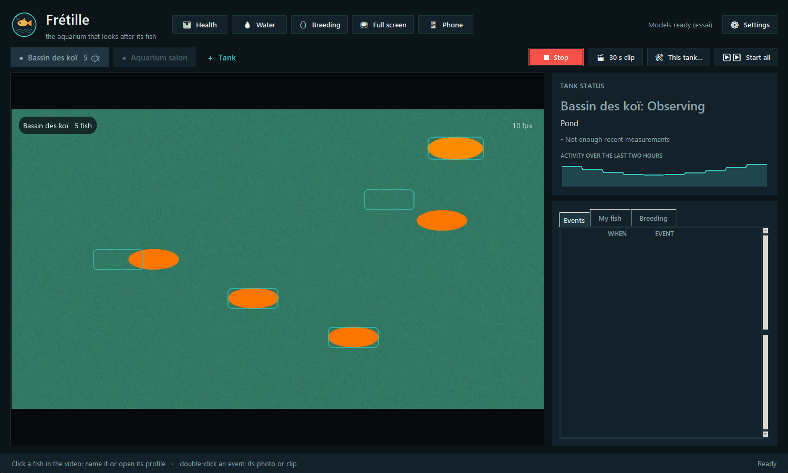
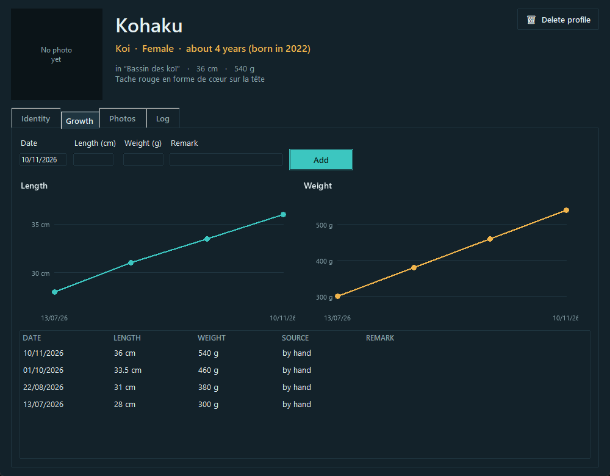
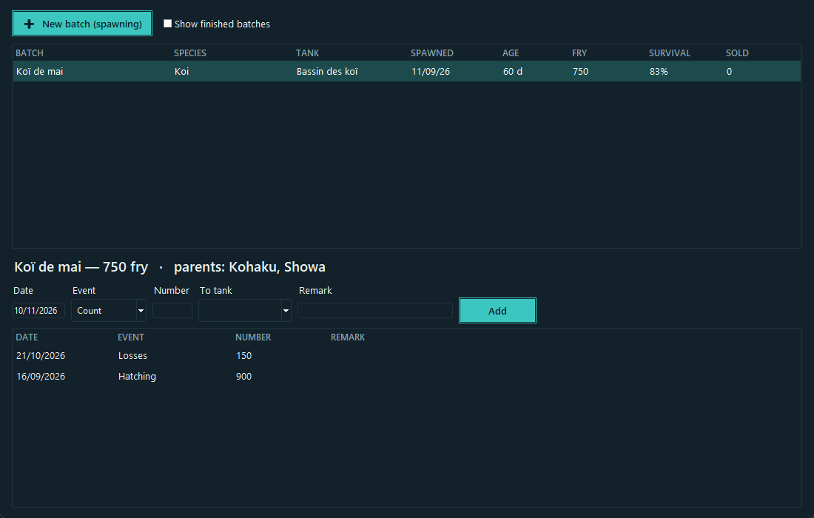
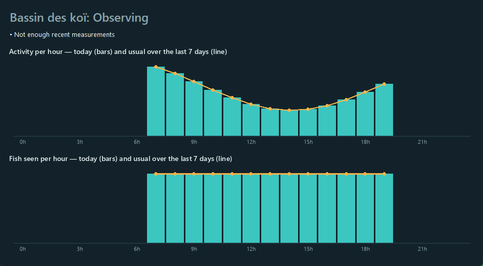
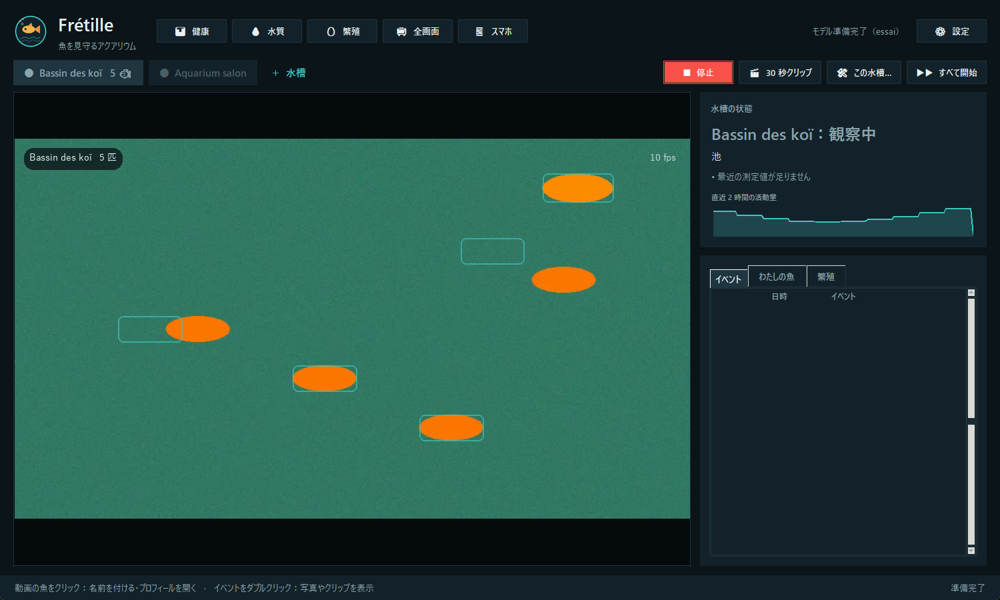

# Frétille

**The aquarium that watches over its fish.** One camera per tank (aquarium, koi pond, breeding tank). Frétille keeps watch for you, day and night, on a Windows PC.

🌍 English · [Français](README.fr.md). The app itself speaks 13 languages: English, Français, Español, Deutsch, Português, Italiano, Nederlands, 中文, 日本語, 한국어, ไทย, Tiếng Việt, Bahasa Indonesia.

**[⬇ Download Fretille-Setup.exe](https://github.com/Oli97430/fretille/releases/latest/download/Fretille-Setup.exe)** · [User guide](GUIDE.en.md) · [Guide en français](GUIDE.md)



*Screenshots show a synthetic test video, not a real tank.*

## Contents

- [What it does](#what-it-does)
- [Install in one click](#install-in-one-click)
- [First steps](#first-steps)
- [What you need](#what-you-need)
- [How it works](#how-it-works)
- [Languages](#languages)
- [Privacy](#privacy)
- [Where your data lives](#where-your-data-lives)
- [Known limits](#known-limits)
- [For developers](#for-developers)
- [Model licences](#model-licences)

## What it does

| | |
|---|---|
| **Tank health** | Counts the fish and measures their activity every minute. Flags fish crowding under the surface (lack of oxygen), staying on the bottom, lethargic or agitated. Each tank is compared with its own habits at the same hour over the previous 7 days. |
| **Motionless fish** | A fish still at the surface for 10 minutes triggers an alert. Elsewhere it is only noted, because some fish sleep on the bottom. |
| **Pond predators** | Heron, egret, kingfisher, bird of prey, cat, rat, otter, raccoon: photo, 30-second clip (including the 5 seconds before) and phone alert. |
| **Individual fish** | Koi, discus, bettas, spotted goldfish: each fish with a unique pattern gets its own record with identity, photos and a log. If the tank is calibrated, its length is measured on video, once a day. |
| **Water log** | pH, NH3/NH4, NO2, NO3, GH, KH, temperature and water changes. Dangerous values are flagged, and you get reminders for water changes and tests. |
| **Breeding** | Fry batches: spawning date, parents, hatching, counts, losses, sales, culling, transfers. Head count and survival rate are worked out for you. |
| **On your phone** | A web page on your home Wi-Fi, protected by a code: live video, tank status, events with photos and clips, and forms to add a measurement, a note or a photo from the pond side. |
| **Alerts anywhere** | With the free ntfy app: predator, motionless fish, lack of oxygen, missing fish, dangerous water, frozen camera image. Each alert is sent once per episode. |
| **Live streaming** | A clean full-screen view for YouTube or OBS: names and ages of recognised fish, "LIVE", the time. Nothing technical or private on screen. |

| Growth of one fish | A fry batch |
|---|---|
|  |  |

## Install in one click

1. Download **[Fretille-Setup.exe](https://github.com/Oli97430/fretille/releases/latest/download/Fretille-Setup.exe)**.
2. Double-click it. No administrator rights are needed.
3. Let the black window work for 5 to 30 minutes, depending on your connection.
4. Start **Frétille** from the desktop shortcut.

What the installer does:

- copies the app to `AppData\Local\Programs\Fretille`;
- uses Python 3.11 if you have it; otherwise downloads it from python.org and checks its signature;
- downloads PyTorch (the NVIDIA build if a card is detected, otherwise the CPU build) and the libraries, about 3 GB;
- adds a desktop and Start-menu shortcut.

Good to know:

- **"Windows protected your PC"**: the installer is not code-signed. Click *More info*, then *Run anyway*.
- **Update or repair**: run the installer again. Your data is not touched.
- **Uninstall**: Windows Settings → Apps → Frétille. Your data and settings are kept.
- **First launch**: the vision models download once, about 1.5 GB.

## First steps

1. Click **＋ Tank** and choose a camera: webcam, an open window (EZVIZ Studio, Mercusys…), a video file or an `rtsp://` stream.
2. **⛶ Crop** the image to the tank. For an aquarium, set the **〰 Water line**.
3. Click **▶ Start**. The first day, Frétille learns the tank's habits.
4. To recognise a fish, click it on the video and give it a name.
5. For phone access and alerts, click **📱 Phone** and scan the QR codes.

The [user guide](GUIDE.en.md) covers every screen.

## What you need

| | Minimum | Better |
|---|---|---|
| System | Windows 10 or 11, 64-bit | |
| Memory | 8 GB | 16 GB |
| Disk | 9 GB free | SSD |
| Graphics | none (analysis every 6 s) | NVIDIA card (analysis every 3 s) |
| Camera | any webcam | an IP camera with a steady, front-on view |

## How it works

For each tank, one thread reads the camera and another analyses the latest image.

1. **Activity** is measured on every image by simple frame difference. It costs almost nothing.
2. **Detection** runs every few seconds with Grounding DINO, asked to find "fish" and, for ponds, "bird, heron, cat, person".
3. **Tracking** links detections from one analysis to the next, using each fish's speed.
4. **Intruders** are identified with BioCLIP (heron, kingfisher, cat…).
5. **Individuals** are recognised with MegaDescriptor plus pattern matching (SIFT), on both flanks.
6. **Health rules** compare the last 30 minutes with the same hours of the previous days. Nothing is judged in the dark.



## Languages

Frétille follows the Windows language when it is one of the 13 available, otherwise English. Change it in **⚙ Settings → Language**. The interface, the phone page, the alerts, the charts, the dates and the decimal separator all follow.



The translations have not yet been proofread by native speakers. Corrections are welcome: each language is one file in [`logiciel/langues`](logiciel/langues).

## Privacy

- Video is analysed on your PC. Nothing is sent to a server.
- The phone page is only reachable on your local network, behind a code. *New code* disconnects every phone.
- Alerts are optional. They go through the public ntfy.sh service, under a random topic name that only you know. They contain the tank name and the event, never an image.

## Where your data lives

By default in `Videos\Fretille`:

| Folder or file | Contents |
|---|---|
| `bacs\<tank>\mesures\` | one line per minute: count, activity, surface, bottom |
| `bacs\<tank>\photos\`, `clips\` | event photos and clips |
| `poissons\` | fish records, recognition galleries, albums |
| `evenements.csv`, `elevage.json` | event log, fry batches |

A daily backup to a USB stick or OneDrive can be switched on in Settings.

## Known limits

- Detection quality on real tanks has not been measured yet: the automated tests use a synthetic video. Expect to adjust cropping and camera position.
- Individual recognition needs fish with distinct patterns, at least 60 pixels long on screen. It will not tell identical neon tetras apart.
- Counting misses fish that hide. Entering the exact number of fish in the tank settings makes the "fish not seen" alert more reliable.
- Windows only.

## For developers

Manual install: Python 3.11, then `logiciel\installer.bat`, then `logiciel\Fretille.bat`.

```bash
cd logiciel
venv\Scripts\python tests\test_regles.py
```

- Tests: `tests\test_regles.py`, `test_moteur.py`, `test_web.py`, `test_revue.py`. They are plain scripts that print OK lines.
- Translations: every visible text goes through `i18n.t("French text")`. `tests\cles_i18n.py` checks that all 12 catalogues are complete.
- Installer: `installateur\fretille.iss` (Inno Setup 6) and `installateur\installer.ps1`.

## Model licences

| Model | Role | Licence |
|---|---|---|
| Grounding DINO tiny | detection | Apache 2.0 |
| BioCLIP | species and intruders | MIT |
| MegaDescriptor | individual recognition | CC BY-NC 4.0, non-commercial use |

Frétille is a sibling of [Broutille](https://github.com/Oli97430/broutille), the tortoise feeder that recognises its tortoises.
